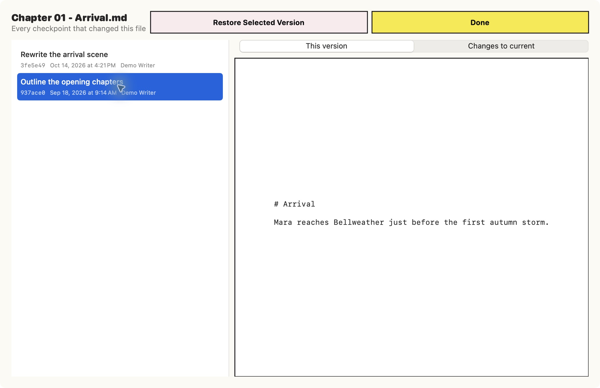

# GittingToIt

**Version control for writers.**

- Three years ago, you made three different versions of the same essay. Now you want to try to get it published, but you can't remember how they differ.
- **GittingToIt** is for that.

GittingToIt is a local, writing-focused Git client for understanding what changed, when it changed, and why alternate copies exist.

This repository contains **application source code only**. It must never contain the user's writing, repository catalog, absolute folder paths, File Notes, Git history exports, credentials, or other private data.



_The screenshot uses a disposable fictional repository; it contains no personal files or real writing._

## Best practices

- Keep large groups of interconnected writing in one large folder that will be managed by this client. You don't need a tab for every piece of writing. You can have sub-folders in the large folder separating each piece of writing, however.
- After every writing session, open GittingToIt, go to the folder that holds your newly edited writing and close the day by hitting "Review and Commit," note the new piece of writing or which file changed, write as much or as little as you want about what you did and then finalize it.
- GittingToIt provides a diary for every file. This is a separate notes file associated with a piece of writing, allowing you to document changes without putting those notes inside the writing itself. It is a good place to log changes, particularly for files edited over a long period of time, and is especially important when you have multiple versions of the same piece of writing.
- **If you want to make a new version** of a file, make the copy from within GittingToIt. This will force you to log why you are making the copy. This is "forking for writers." By logging what you're doing, you will be more likely to be able to know which file to use in the future.
- If you keep images or other multimedia in the same folders as your writing, select "Ignore" on those files in the dialogue when making a commit (unless you modify these files a lot, you'll just be burning Git repository storage by tracking them).

## Current checkpoint

The native macOS prototype includes:

- Explicit folder addition with a default starting location of `Documents/Sync`
- Protection against accidental nested repositories
- Repository tabs and removal from the local library without deleting data
- Branch, current commit, and working-change summaries
- Commit history with hashes, dates, times, messages, and changed files
- Fast document and commit-history filtering
- Writing-document discovery for Markdown, text, RTF, Word, and PDF files
- Creation, modification, and last-committed dates
- Per-file Git history
- Background history warming for recently edited documents
- Exact historical text preview and word-focused comparison with the current file
- A dated, editable notes diary stored in human-readable `GittingToIt Notes.md`
- Documented related copies named `filename c YYYYMMDD.ext`
- Documented forks made from any historical version without replacing the current file
- Required purpose notes for copies
- Automatic family-history notes whenever a known original or copy is checkpointed
- A bold, high-contrast visual system
- Selective checkpoints that cannot include unrelated staged work
- Per-file and grouped ignore controls, including convenient rules for Finder metadata and image-heavy folders
- Safe one-file restoration with an automatic safety checkpoint for current edits

Compare/reconcile and richer text-diff views remain planned work.

## Run locally

Requirements: macOS 14 or newer and Swift 6 command-line tools.

```sh
swift run
```

Run tests with:

```sh
swift test
```

Check the repository for common private paths and secrets before publishing:

```sh
Scripts/public-safety-check.sh
```

Package a launchable local app with:

```sh
chmod +x Scripts/package-app.sh
Scripts/package-app.sh
open .build/GittingToIt.app
```

## Privacy boundary

- The app has no analytics, telemetry, advertising, or network client.
- It scans only folders explicitly added by the user.
- The repository catalog is stored in the user's Application Support directory, outside this source repository.
- The default Sync location is constructed from the current user's home directory at runtime; no username or private absolute path is compiled into the app.
- File Notes live beside the documented writing because they belong to that writing repository, not this application repository.

See [PRIVACY.md](PRIVACY.md) and [SECURITY.md](SECURITY.md) before publishing.

## License

GittingToIt is open-source software available under the [MIT License](LICENSE). Use it, modify it, and share it however you like under those terms.
